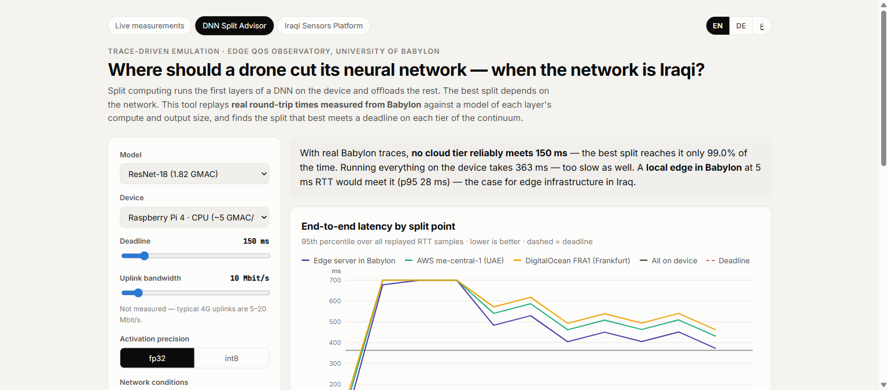
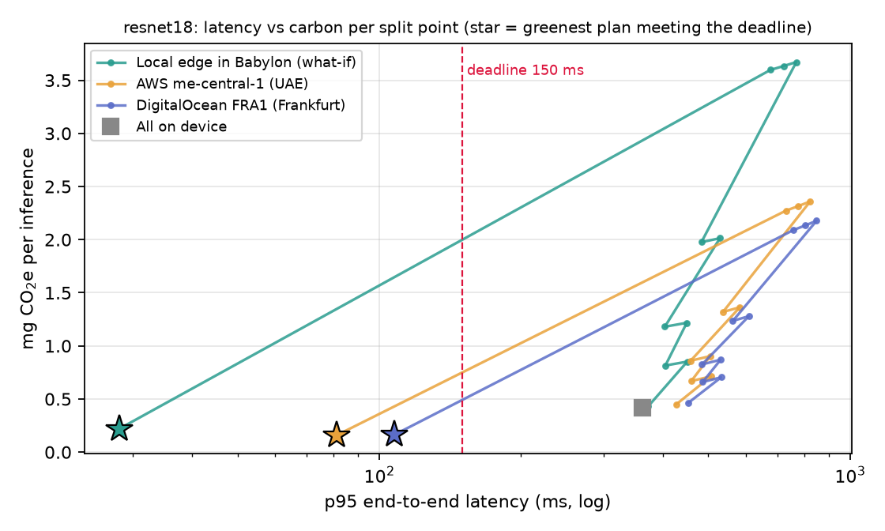
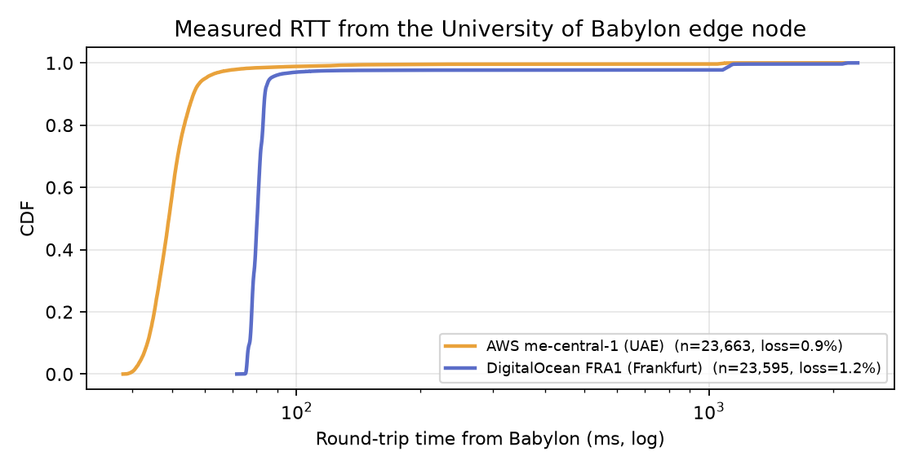
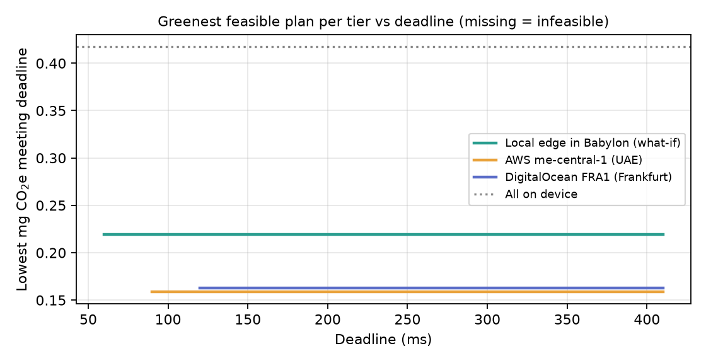
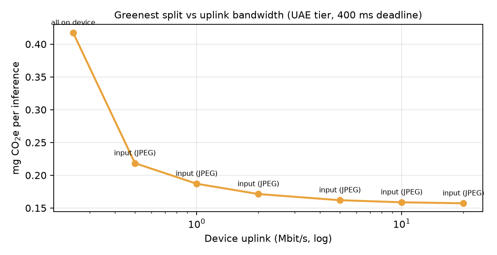

# Carbon-Aware Split Computing from Babylon, Iraq

**Where should an AI model run (device, local edge or cloud) so that it meets its deadline with the least carbon?**
The tool answers this using **real network measurements** taken from the University of Babylon, Iraq.

This repository extends the live **DNN Split Advisor** of my edge research platform
([menti.ameer.itbabylon.org](https://menti.ameer.itbabylon.org)) from a latency-only objective to a
**latency + energy + carbon** objective.


*The live platform replays round-trip times measured every 10 s from Babylon. This repository adds energy and carbon to the same model.*

## What it does

1. **Measured traces.** About 66 hours of TCP round-trip samples from the Babylon edge node to AWS me-central-1 (UAE, 23,663 samples) and DigitalOcean FRA1 (Frankfurt, 23,595 samples), plus lost probes. Snapshot in `data/`; `--fetch` downloads fresh data from the public API.
2. **Exact workload model.** Per-layer MACs and activation sizes of **ResNet-18** (1.82 GMAC) and **MobileNetV2** (0.30 GMAC) for 224×224 input. Every layer boundary is a candidate split point.
3. **Latency.** Device compute + upload + **measured RTT** + server compute, replayed over every sample. This gives the p95 latency and the deadline-hit ratio.
4. **Energy and carbon.** Device energy (compute, radio, waiting), server energy, and network transport energy, each weighted by the carbon intensity of the grid where it is consumed.
5. **Decision.** For every tier, the **greenest split** that meets the deadline in ≥ 95 % of samples.

## Results (ResNet-18 on a Raspberry Pi 4, 10 Mbit/s uplink, 150 ms deadline)

| Tier | Greenest feasible split | p95 latency | Deadline hit | mg CO₂e / inference |
|---|---|---|---|---|
| Local edge in Babylon (what-if, 5 ms RTT) | send JPEG | 28 ms | 100 % | 0.22 |
| **AWS UAE (measured)** | send JPEG | 81 ms | 98.4 % | **0.16** |
| DigitalOcean Frankfurt (measured) | send JPEG | 108 ms | 96.4 % | 0.16 |
| All on device | – | 363 ms | 0 % | 0.42 |



**Findings** (under the stated assumptions):
- Running everything on the Raspberry Pi is **too slow (363 ms)** and emits about **2.6× more carbon** than offloading. The device works longer, and on a carbon-intensive grid.
- The **UAE region** is both the fastest real cloud and the greenest feasible option from Iraq. Frankfurt is feasible only for deadlines of about 120 ms or more.
- A **local edge in Babylon** is the only option for deadlines under about 90 ms. On today's Iraqi grid, though, it costs about 40 % more carbon than the UAE cloud. **Edge infrastructure in Iraq needs cleaner power to be the sustainable choice, not only the fast one.**
- Under about 0.25 Mbit/s of uplink, offloading stops paying off and the greenest plan becomes **all on device**.





## Assumptions (please replace with measurements)

The latency model uses measured data. The **energy and carbon parameters are illustrative assumptions** and are set
in `carbonsplit/evaluate.py` and `run.py`:

| Parameter | Default | Note |
|---|---|---|
| Raspberry Pi 4 throughput | 5 GMAC/s | same as the live advisor |
| Device power: compute / idle / radio | 6.0 / 2.7 / +1.0 W | typical board values; measure with a USB power meter |
| Server energy | 0.36 J per GMAC | ≈ 300 W accelerator at 1 TMAC/s × PUE 1.2 |
| Network transport | 0.006 kWh/GB | order-of-magnitude estimate |
| Grid carbon intensity | Iraq 690, UAE 420, Germany 380 g CO₂e/kWh | illustrative; use live data, e.g. Electricity Maps |

Next steps: on-device power measurements, live grid-intensity feeds, int8 activations, and time-of-day carbon-aware scheduling.

## Run it

```bash
pip install -r requirements.txt
python run.py                          # ResNet-18, 150 ms deadline, snapshot data
python run.py --model mobilenetv2 --deadline 120
python run.py --fetch 72               # refresh traces from the live platform first
```

Outputs: `figures/*.png` and `figures/summary.json`.

## Author

**Dr. Ameer Kadhim Hadi**, Assistant Professor of Computer Science, University of Babylon, Iraq.
Cloud–edge systems, network QoS and sustainable edge AI.
[Website](https://ameerkhadi.github.io/academic-cv-website/) · [Live platform](https://menti.ameer.itbabylon.org) · ameer.hadi@uobabylon.edu.iq

MIT License.
